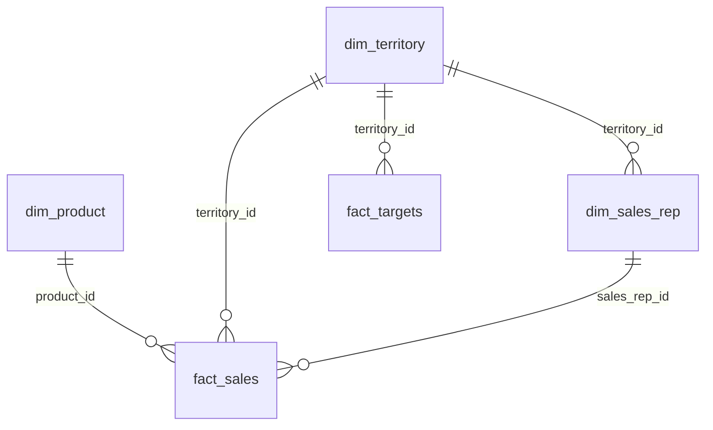

# Project brief — Pharma Sales Intelligence & ETL Analytics System

**Problem statement:** A fictional pharmaceutical company cannot reliably compare product/territory revenue against monthly sales targets because transaction files are dispersed and contain quality issues.

**Users:** regional sales managers, commercial analysts.

**Deliverables:** reproducible synthetic CSVs; automated validation & ETL; normalized SQL database; SQL analyses; Power BI dashboard (built separately); README with business insights and limitations.

**Core KPIs:** revenue, transactions, units sold, sales by brand/category/region, target attainment, month-over-month growth.

## Logical data model

## Out-of-scope for V1
No real patient records or personal data; no predictive ML; no cloud, Docker or API; no claims that synthetic results represent market performance.

## What to present in interviews
Explain how you validated rows, separated fact/dimension tables, prevented double-counting targets during joins, and turned SQL outputs into a sales decision.
